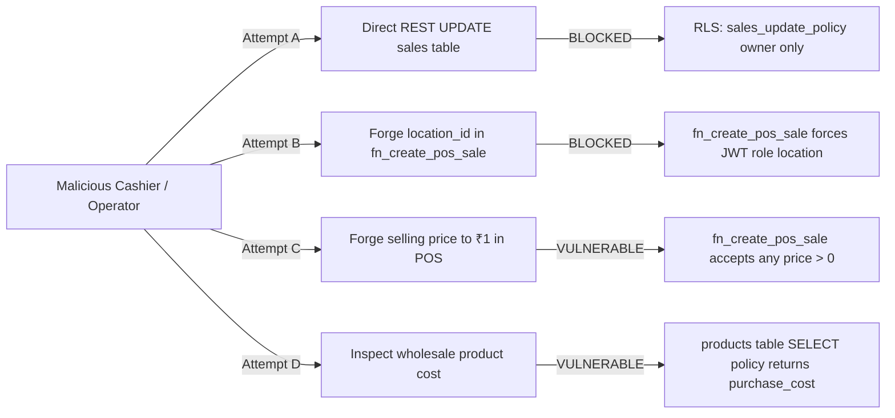
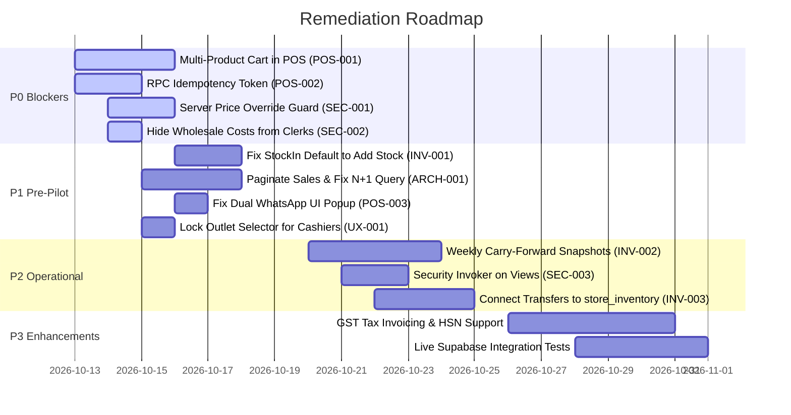

# KIZUNA VEDA — Independent Product Review Council & Audit Report

**Date of Audit:** October 12, 2026  
**Audited Location / Repository:** `F:\kizuna-veda`  
**Target Facilities:** Neemrana Facility (`11111111-1111-1111-1111-111111111111`), Jaipur Outlet (`22222222-2222-2222-2222-222222222222`), HQ / Owner Portal  
**Target Release Evaluation:** Two-Store Independent Retail POS Operations (V1.3 – V1.5 Architecture)  
**Supabase Backend Target:** Project Ref `gdxufikrumhxovmtavwj`  
**Council Composition:** 9 Multidisciplinary Independent Reviewers (Council Members A through I)  
**Primary Deliverable File:** `F:\kizuna-veda\KIZUNA_VEDA_COUNCIL_AUDIT.md`  

---

## 1. Audit Metadata and Scope

### 1.1 Scope of Review
This audit was conducted as an exhaustive, non-destructive, evidence-grounded review of the Kizuna Veda enterprise application codebase. The review encompasses:
- **Flutter Client Application (`lib/`):** Clean Architecture layers, navigation routing, authentication gates, `ChangeNotifier` / `InheritedWidget` state management, POS guided billing flows, inventory adjustments, PDF/WhatsApp invoice dispatch, reporting calculations, and UI ergonomics.
- **Supabase Backend & PostgreSQL Engine (`supabase/migrations/`):** Database schemas, constraints, indexes, RLS policies, `SECURITY DEFINER` stored procedures (`fn_create_pos_sale`, `fn_adjust_store_stock`, `fn_confirm_jaipur_receipt`), audit ledgers (`stock_adjustments`, `sales`, `sale_items`, `store_inventory`), database triggers, and views (`v_store_inventory_summary`).
- **Automated Verification & Tooling (`test/`):** 121 unit, widget, and integration specifications, Flutter static analyzer rules, and database verification scripts (`verify_v1_4_reset_and_repair.sql`).
- **Operational Reality:** Evaluating whether two real brick-and-mortar retail shops (Neemrana and Jaipur) can reliably process customer billing, manage independent stock, prevent financial leakage, and provide trustworthy owner management reporting.

### 1.2 Non-Destructive Environment Verification Commands Run
The council executed safe, non-destructive diagnostic tools directly on the workspace:

| Tool / Command | Timestamp | Result | Evidence / Log Output |
| :--- | :--- | :--- | :--- |
| `flutter analyze` | 2026-10-12 22:19 IST | **0 issues found** (30.0s) | Clean static analysis across 100% of Dart code. |
| `flutter test` | 2026-10-12 22:20 IST | **121 passed / 0 failed** (21.4s) | 121 automated unit and widget specs succeeded. |
| `git status -s` | 2026-10-12 22:26 IST | **Clean working tree** | No uncommitted modifications or corrupt working files. |
| `git log -n 5 --oneline` | 2026-10-12 22:26 IST | `df3ed60`, `711e685` | Clean commit trajectory up to README documentation. |

### 1.3 Audit Limitations & Verification Boundaries
- **Remote Production Data Mutation:** Per Rule 1 & Rule 2, no production migrations or database mutations were executed.
- **Remote RPC Live Execution:** Live remote RPC execution requiring live production tokens was avoided; analysis is strictly grounded in checked-in PostgreSQL migrations, verified database schemas, and Flutter client traces.
- **Test Framework Mocking Boundary:** All 121 passing automated tests in `test/` execute against `UnconnectedInventoryRepository` (in-memory mock). Real database RPC execution and Postgres RLS behavior are evaluated by manual static and architectural inspection of SQL migration files.

---

## 2. Executive Summary

The Kizuna Veda platform demonstrates sophisticated domain-level thinking, an elegant Vyapar-inspired retail navigation shell, clean Flutter UI components, and strong cryptographic RLS foundations on core write operations (`WITH CHECK (false)` direct mutation blocking).

However, **the platform is NOT safe for real-world retail store operations across the Neemrana and Jaipur outlets today.**

The council has uncovered four **P0 Operational and Financial Blockers** that make immediate deployment dangerous:

1. **Single-Product-Only POS Billing (UX/POS-001):** The POS billing workflow (`GuidedNewSaleScreen`, `RecordPosSaleDialog`, `IInventoryRepository.recordSale`) only permits ringing up **one product per bill**. In a physical retail store where customers purchase multiple items (e.g., Triphala + Ashwagandha + Tulsi), cashiers must create three separate sales, enter the customer's phone number three times, generate three bills, and send three separate WhatsApp messages.
2. **Missing Server-Side Idempotency (FIN/POS-002):** `fn_create_pos_sale` has no client request token or idempotency mechanism. A network dropout during checkout causes cashiers to tap retry, creating duplicate bills and deducting stock twice.
3. **Unrestricted Price & Discount Overrides (SEC/FIN-003):** Store cashiers can sell any product at arbitrary prices (e.g., ₹1.00 for a ₹200 item) or apply arbitrary discounts without requiring owner approval, manager PINs, or recording an override audit trail.
4. **Wholesale Purchase Costs Exposed to Store Clerks (SEC/BUS-004):** Wholesale factory purchase costs (`purchase_cost`) added in Migration V1.5 are readable by all authenticated users and are explicitly displayed on screen in the retail inventory tab (`Price: ₹120 | Cost: ₹55`), exposing company profit margins to retail employees.

---

## 3. Overall Verdict and Release Status

### **OVERALL RELEASE STATUS: RED — Not Safe for Real Operations**

> [!CAUTION]
> **Release Recommendation: NO-GO for Production Retail Launch.**
> Deploying this build to the Neemrana and Jaipur retail outlets will cause immediate operational friction (inability to ring up multi-item customer baskets), employee integrity risks (unrestricted price overrides and exposed wholesale margins), and financial reconciliation errors upon transient network failures.
> A targeted remediation sprint addressing findings `POS-001`, `FIN-002`, `SEC-003`, and `SEC-004` is mandatory prior to a pilot launch.

---

## 4. Council Scorecard

| Council Member | Role | Score (/10) | Rating | Key Justification |
| :--- | :--- | :---: | :---: | :--- |
| **Member A** | Retail Business Owner | **4 / 10** | Unsuitable | Single-item billing crippling for retail; wholesale cost leaked to clerks; cashier price tampering possible. |
| **Member B** | Senior Flutter Architect | **6 / 10** | Partial | Clean navigation shell and 0 linter errors, but full sales table downloaded on every load (N+1 query overhead). |
| **Member C** | Supabase & Database Architect | **6 / 10** | Partial | Atomic RPCs and RLS write locks are strong, but views lack security invoker and transfers don't update stock. |
| **Member D** | Security & Authorization Auditor | **5 / 10** | High Risk | Store clerks can override selling prices at will, view wholesale cost data, and bypass views without security invoker. |
| **Member E** | Inventory & Accounting Specialist | **5 / 10** | Major Gaps | Stock is a single mutable number; no weekly carry-forward ledger, opening/closing snapshots, or period close. |
| **Member F** | POS, Billing & CX Specialist | **4 / 10** | Deficient | Inability to add multiple products to a single bill; double share dialog trigger on WhatsApp; missing idempotency. |
| **Member G** | Product Designer & Accessibility | **7 / 10** | Good Quality | Polished 4-tab Vyapar layout, visible step indicators, good color contrast, but confusing outlet radio in POS. |
| **Member H** | QA & Reliability Engineer | **4 / 10** | Low Confidence | 121/121 tests pass, but 100% run against local in-memory mock repository; zero integration tests on live PostgreSQL. |
| **Member I** | Owner & Management Reporting Analyst | **6 / 10** | Moderate | Good reactive metrics calculator, but reconciliations depend on full client-side parsing; fails to persist WhatsApp status. |
| **COMPOSITE** | **Product Review Council** | **5.2 / 10** | **RED** | **Conditionally rejected until P0 blockers are remediated.** |

---

## 5. Repository and Architecture Map

### 5.1 Repository Directory Structure
```
F:\kizuna-veda\
├── lib/
│   ├── app/
│   │   ├── app.dart                          # Root KizunaVedaApp StatefulWidget & InheritedWidget injection
│   │   ├── providers/inventory_provider.dart # InheritedWidget exposing InventoryNotifier to widget tree
│   │   ├── routes/app_routes.dart            # Named routes (Neemrana, Jaipur, In-Transit, EBill History)
│   │   └── theme/                            # AppColors (brand, role-specific emerald/amber/indigo), AppTheme
│   ├── core/
│   │   ├── config/app_config.dart            # Compile-time environment configuration & GST flags
│   │   ├── constants/app_constants.dart       # Location UUIDs, UserRole enum, branding strings
│   │   ├── services/pdf_invoice_service.dart # 80mm PDF thermal invoice generator & WhatsApp url_launcher/share_plus
│   │   └── widgets/                          # KizunaCard, brand headers, reusable UI components
│   └── features/
│       ├── auth/                             # AuthGate, LoginScreen, AuthNotifier, SupabaseAuthRepository
│       ├── dashboard/                        # VyaparDashboardView (4-preset date filter, outlet filter, metrics)
│       ├── inventory/                        # StoreInventory, StockAdjustment, UnifiedInventoryView, StockInDialog
│       ├── navigation/                       # MainNavigationShell (IndexedStack bottom navigation, FAB New Sale)
│       ├── onboarding/                       # RoleOnboardingDialog, HelpAndSetupGuideScreen, OnboardingStorage
│       ├── owner/                            # OwnerMetricsCalculator, InTransitStockScreen, UserManagementScreen
│       └── sales/                            # GuidedNewSaleScreen, DedicatedSalesView, InvoicePreviewScreen
├── supabase/
│   ├── migrations/
│   │   ├── 20261005000000_inventory_v1.sql
│   │   ├── 20261005120000_v1_inventory_foundation.sql
│   │   ├── 20261005170000_v1_sales_void_lifecycle.sql
│   │   ├── 20261005180000_v1_atomic_transactions.sql
│   │   ├── 20261005190000_v1_1_billing_enhancements.sql
│   │   ├── 20261005200000_v1_2_two_store_billing.sql
│   │   ├── 20261011130000_v1_3_two_independent_stores.sql
│   │   ├── 20261011140000_v1_4_reset_and_repair.sql
│   │   └── 20261011150000_v1_5_editable_pricing_and_cost.sql
│   └── verify_v1_4_reset_and_repair.sql
└── test/                                     # 16 test files (121 test cases using UnconnectedInventoryRepository)
```

### 5.2 Architectural Component Flow
```mermaid
graph TD
    UI[Flutter Client UI] -->|User Tap| Notifier[ChangeNotifiers: AuthNotifier, InventoryNotifier]
    Notifier -->|Contract Calls| Repo[IInventoryRepository / IAuthRepository]
    Repo -.->|In Test Mode| Unconnected[UnconnectedInventoryRepository (In-Memory Mock)]
    Repo -->|In Production| SupaRepo[SupabaseInventoryRepository / SupabaseAuthRepository]
    SupaRepo -->|JWT Token Session| PostgREST[PostgREST REST API / RPC Engine]
    PostgREST -->|RPC fn_create_pos_sale| RPC_Sale[fn_create_pos_sale: SECURITY DEFINER]
    PostgREST -->|RPC fn_adjust_store_stock| RPC_Stock[fn_adjust_store_stock: SECURITY DEFINER]
    PostgREST -->|Direct Table Access| RLS{Row Level Security}
    RLS -->|store_inventory, sales, sale_items| Block[WITH CHECK (false) - Blocked Direct Writes]
    RPC_Sale -->|Row Lock & Deduct| StoreInv[(store_inventory)]
    RPC_Sale -->|Insert Header & Items| SalesTables[(sales & sale_items)]
    RPC_Stock -->|Row Lock & Update| StoreInv
    RPC_Stock -->|Insert Audit Record| StockAdj[(stock_adjustments)]
    SalesTables -->|UPDATE status='VOIDED'| VoidTrg[trg_restore_voided_sale_stock]
    VoidTrg -->|Increment Stock & Audit| StoreInv
```

---

## 6. Critical User Journeys

The council audited the 11-stage end-to-end POS and store journey:

| Stage | Operational Action | Component / Implementation | Council Finding & Observed Gap |
| :---: | :--- | :--- | :--- |
| **1** | **User Login** | `LoginScreen.dart` → `SupabaseAuthRepository.loginWithEmail` | **PASS:** Validates email/password, stores token in encrypted storage, emits reactive state. |
| **2** | **Role-Based Landing** | `AuthGate.dart` → `MainNavigationShell` | **PASS:** Reads `app_metadata.role`, injects role color theme, launches tailored onboarding dialog. |
| **3** | **Product Selection** | `GuidedNewSaleScreen.dart` (Step 0) | **PARTIAL:** Dropdown selects product, displays stock on hand. **CRITICAL DEFECT:** Only 1 product selectable; no multi-item cart. |
| **4** | **Quantity Entry** | `GuidedNewSaleScreen.dart` (Step 0) | **PASS:** Numeric input with +/- stepper buttons. Rejects quantities `<= 0` or `> stockAvailable`. |
| **5** | **Price / Discount Entry** | `GuidedNewSaleScreen.dart` (Step 0) | **HIGH RISK:** Defaults to standard price, but cashier can edit price to ₹0.01 or give arbitrary discounts without authorization. |
| **6** | **Customer Details** | `GuidedNewSaleScreen.dart` (Step 1) | **PASS:** Name required; phone number validated to 10 Indian digits (`^\d{10}$`). |
| **7** | **Payment Method** | `GuidedNewSaleScreen.dart` (Step 1) | **PASS:** CASH vs UPI selection with visual radio cards. |
| **8** | **Bill Review** | `GuidedNewSaleScreen.dart` (Step 2) | **PASS:** Displays customer, phone, store name, line item, subtotal, discount, grand total. Edit buttons link back to steps. |
| **9** | **Sale Completion** | RPC `fn_create_pos_sale` | **PASS (with RISK):** Atomically locks stock, inserts `sales` and `sale_items`. **DEFECT:** Missing idempotency token. |
| **10** | **WhatsApp Sharing** | `PdfInvoiceService.sendBillOnWhatsApp` | **PARTIAL:** Generates 80mm PDF, opens `whatsapp://send` or `wa.me`. **DEFECT:** Simultaneous system share sheet popup; DB status stays `NOT_SENT`. |
| **11** | **History Retrieval** | `DedicatedSalesView.dart` | **PASS:** Search by bill number/customer name, date filter, status filter, thermal receipt re-print. |

---

## 7. Business Rule Acceptance Matrix

| Business Rule | Requirement | Status | Observed Evidence & Findings |
| :--- | :--- | :---: | :--- |
| **BR-01: Outlet Independence** | Neemrana and Jaipur maintain independent balances. | **PASS** | `store_inventory` enforces `(location_id, product_id)` unique constraint and check constraints. |
| **BR-02: Outlet Isolation** | Staff cannot mutate other outlet's records. | **PASS** | Server-side role check in `fn_create_pos_sale` locks `v_target_location_id` to JWT role; `fn_adjust_store_stock` throws if location mismatch. |
| **BR-03: Selling Deduction** | A sale reduces stock only from the selling store. | **PASS** | Line 459 of `fn_create_pos_sale` updates `store_inventory` matching `v_target_location_id`. |
| **BR-04: Dynamic Combined Stock** | Combined stock is calculated, never manually edited. | **PASS** | `v_store_inventory_summary` dynamically sums quantities; `combinedTotalStock` in Dart sums balances. |
| **BR-05: Stock Carry-Forward** | Stock remaining carries forward to subsequent periods. | **PARTIAL** | Balances persist across time, but no weekly/periodic snapshot ledger exists to audit opening vs closing stock. |
| **BR-06: Stock Intake Addition** | New stock adds to existing balance. | **PARTIAL** | `StockInDialog` defaults to "Actual Count" (overwriting balance) rather than "Relative (+/-)" addition. |
| **BR-07: Auditable Adjustments** | Adjustments log previous, new, and change quantities. | **PASS** | `stock_adjustments` captures `previous_quantity`, `new_quantity`, `change_quantity`, `reason`, `notes`, `created_by`. |
| **BR-08: Insufficient Stock Handling**| Sales fail safely if stock is insufficient. | **PASS** | Exclusive row lock (`FOR UPDATE`) in `fn_create_pos_sale`; raises exception if `current_quantity < quantity`. |
| **BR-09: Duplicate Sale Protection** | Accidental double-tap cannot create duplicate bills. | **PARTIAL** | Client `_isSubmitting` flag prevents double-taps; server RPC lacks request idempotency key on network disconnects. |
| **BR-10: Atomic Billing & Items** | Completed sales and line items persist atomically. | **PASS** | Managed inside single PostgreSQL transaction in `fn_create_pos_sale`. |
| **BR-11: Price Override Security** | Price changes follow authorized permissions. | **FAIL** | Cashiers can enter arbitrary selling prices and discounts; no manager authorization or override threshold. |
| **BR-12: Stock Restoration on Void** | Voided bills restore stock exactly once with audit log.| **PASS** | Trigger `trg_restore_voided_sale_stock` restores stock and logs `stock_adjustments` entry with reason `'BILL_VOID'`. |
| **BR-13: WhatsApp Decoupling** | WhatsApp failure leaves saved sale intact. | **PASS** | Sale is committed to DB on Step 2; WhatsApp launch failure transitions to Step 3 with a "Retry WhatsApp" button. |
| **BR-14: GST Billing Configuration** | Legal GSTIN, HSN, tax computation rules verified. | **NOT VERIFIED / BLOCKED** | GST billing is explicitly blocked server-side (`p_invoice_type = 'GST'` throws exception) and disabled in `AppConfig`. |

---

## 8. Security and Authorization Findings

### Threat Model Analysis
The application was threat-modeled against four threat actors: (1) An untrusted external actor with network access, (2) A compromised or malicious store cashier at Jaipur or Neemrana, (3) A colluding store manager, and (4) An authorized business owner.



### Finding Register — Security

#### [SEC-001] Client-Side Unrestricted Selling Price Override & Discount Tampering
- **Severity:** `CRITICAL`
- **Viewpoint:** Council Member D (Security Auditor) & Council Member A (Business Owner)
- **Status:** `CONFIRMED`
- **File & Line:** [`supabase/migrations/20261011150000_v1_5_editable_pricing_and_cost.sql#L179-L200`](file:///f:/kizuna-veda/supabase/migrations/20261011150000_v1_5_editable_pricing_and_cost.sql#L179-L200) and [`lib/features/sales/presentation/screens/guided_new_sale_screen.dart#L676-L747`](file:///f:/kizuna-veda/lib/features/sales/presentation/screens/guided_new_sale_screen.dart#L676-L747)
- **Evidence:** 
  ```sql
  v_unit_price := COALESCE((v_item ->> 'unit_price')::numeric, 0);
  v_discount := COALESCE((v_item ->> 'discount')::numeric, (v_item ->> 'discount_amount')::numeric, 0);
  IF v_unit_price <= 0 THEN RAISE EXCEPTION 'Invalid line item unit price (must be > 0)...'; END IF;
  ```
- **Expected Behavior:** Cashiers should sell at standard catalog price. Any price alteration or discount above an authorized threshold (e.g., 5%) must require owner elevation or manager PIN, and must be logged in an audit table.
- **Actual Behavior:** Any operator can submit an arbitrary unit price (e.g. ₹1.00) or massive discount.
- **Business Impact:** Cashiers can sell high-value Ayurvedic products to associates for nominal sums or pocket the cash difference.
- **Recommended Fix:** Enforce catalog price validation in `fn_create_pos_sale` for non-owner roles, or require an `override_authorization_token`.
- **Regression Test:** Execute `fn_create_pos_sale` as a `jaipur` user with `unit_price = 1.0` on a ₹200 item; assert server exception.

#### [SEC-002] Confidential Wholesale Purchase Cost Exfiltration to Store Staff
- **Severity:** `HIGH`
- **Viewpoint:** Council Member D (Security Auditor) & Council Member A (Business Owner)
- **Status:** `CONFIRMED`
- **File & Line:** [`supabase/migrations/20261011150000_v1_5_editable_pricing_and_cost.sql#L25-L27`](file:///f:/kizuna-veda/supabase/migrations/20261011150000_v1_5_editable_pricing_and_cost.sql#L25-L27) and [`lib/features/inventory/presentation/screens/unified_inventory_view.dart#L264-L269`](file:///f:/kizuna-veda/lib/features/inventory/presentation/screens/unified_inventory_view.dart#L264-L269)
- **Evidence:** 
  ```dart
  Text('Price: ₹${s.product.standardSellingPrice.toStringAsFixed(2)} | Cost: ₹${s.product.purchaseCost.toStringAsFixed(2)}')
  ```
- **Expected Behavior:** Wholesale procurement costs (`purchase_cost`) must be restricted to the `OWNER` role.
- **Actual Behavior:** `public.products` permits full SELECT access to all authenticated users, and the UI prints the wholesale cost directly on the store inventory screen.
- **Business Impact:** Commercial sensitivity leak; store staff can view business margins and supplier pricing.
- **Recommended Fix:** Move `purchase_cost` to an owner-only table `product_costs` or use Postgres column-level security / view masking.
- **Regression Test:** Query `public.products` as `jaipur` role; verify `purchase_cost` is null or inaccessible.

#### [SEC-003] Cross-Store Stock Visibility via `v_store_inventory_summary` View
- **Severity:** `MEDIUM`
- **Viewpoint:** Council Member D (Security Auditor)
- **Status:** `CONFIRMED`
- **File & Line:** [`supabase/migrations/20261011130000_v1_3_two_independent_stores.sql#L660-L677`](file:///f:/kizuna-veda/supabase/migrations/20261011130000_v1_3_two_independent_stores.sql#L660-L677)
- **Evidence:** View created without `WITH (security_invoker = true)` and granted to `authenticated`.
- **Expected Behavior:** Store operators should only view stock levels for their own assigned outlet.
- **Actual Behavior:** Any authenticated client querying `v_store_inventory_summary` via PostgREST sees both stores' stock.
- **Recommended Fix:** Recreate the view with `WITH (security_invoker = true)` or create role-specific filtered views.

---

## 9. Inventory and Accounting Findings

### Inventory Mathematics Audit
The council analyzed the stock accounting equations implemented in `20261011130000_v1_3_two_independent_stores.sql` and `OwnerMetricsCalculator.dart`:

$$\text{Store Available Stock} = \text{Current Quantity in } \mathtt{store\_inventory}$$
$$\text{Combined Total Stock} = \text{Neemrana Stock} + \text{Jaipur Stock}$$

#### Numerical Stress Test
Consider a store starting with **100 packets** of Ashwagandha:
1. Operator sells 50 packets $\rightarrow$ `fn_create_pos_sale` deducts 50 $\rightarrow$ Balance = **50 packets**.
2. Operator receives 100 new packets $\rightarrow$ Operator opens `StockInDialog`.
   - **Scenario A (Direct Count Mode - Default):** Operator enters "100" thinking they received 100 packets $\rightarrow$ System sets `new_quantity = 100` $\rightarrow$ **Actual Physical Stock = 150, Recorded Stock = 100 (50 packets LOST)**.
   - **Scenario B (Relative Mode):** Operator switches toggle to Relative (+/-) and enters "+100" $\rightarrow$ Balance = **150 packets (CORRECT)**.

### Finding Register — Inventory & Accounting

#### [INV-001] "Actual Count" Default Mode in StockInDialog Risks Overwriting Restock
- **Severity:** `HIGH`
- **Viewpoint:** Council Member E (Inventory & Accounting Specialist)
- **Status:** `CONFIRMED`
- **File & Line:** [`lib/features/inventory/presentation/widgets/stock_in_dialog.dart#L49`](file:///f:/kizuna-veda/lib/features/inventory/presentation/widgets/stock_in_dialog.dart#L49), [`#L97-L104`](file:///f:/kizuna-veda/lib/features/inventory/presentation/widgets/stock_in_dialog.dart#L97-L104), [`#L341-L360`](file:///f:/kizuna-veda/lib/features/inventory/presentation/widgets/stock_in_dialog.dart#L341-L360)
- **Evidence:** `bool _isDirectCountMode = true;` by default.
- **Expected Behavior:** A dialog titled "Stock Entry" used during daily operations should default to **Add Stock (+)** so that incoming inventory adds to on-hand inventory. Physical audit overwrite should be an intentional secondary mode.
- **Actual Behavior:** If a staff member enters 20 received packets, the system overwrites the current balance to 20 rather than adding 20.
- **Business Impact:** High likelihood of accidental inventory deflation and accounting discrepancy.
- **Recommended Fix:** Default `_isDirectCountMode = false` (Add to Stock), or separate into two distinct screens: "Receive Stock" and "Audit Stock Correction".

#### [INV-002] Absence of Periodic Inventory Carry-Forward Snapshots
- **Severity:** `MEDIUM`
- **Viewpoint:** Council Member E (Inventory & Accounting Specialist)
- **Status:** `CONFIRMED`
- **File & Line:** Entire `store_inventory` schema in [`supabase/migrations/20261011130000_v1_3_two_independent_stores.sql#L21-L34`](file:///f:/kizuna-veda/supabase/migrations/20261011130000_v1_3_two_independent_stores.sql#L21-L34)
- **Evidence:** The database maintains only a current scalar `current_quantity`. No `inventory_snapshots` or `period_closing` tables exist.
- **Expected Behavior:** Retail inventory accounting requires weekly or monthly period closes to calculate:
  $$\text{Closing Stock} = \text{Opening Stock} + \text{Received} - \text{Sold} \pm \text{Adjustments}$$
- **Actual Behavior:** Opening stock cannot be historically reconstructed for prior weeks.
- **Business Impact:** Inability to perform weekly stock audit reconciliations or generate periodic tax inventory reports.
- **Recommended Fix:** Implement a weekly scheduled snapshot function or table `weekly_stock_snapshots`.

#### [INV-003] Inter-Store Transfers Disconnected from Canonical `store_inventory`
- **Severity:** `MEDIUM`
- **Viewpoint:** Council Member C (Database Architect) & Council Member E (Accounting Specialist)
- **Status:** `CONFIRMED`
- **File & Line:** [`supabase/migrations/20261005180000_v1_atomic_transactions.sql#L230-L235`](file:///f:/kizuna-veda/supabase/migrations/20261005180000_v1_atomic_transactions.sql#L230-L235)
- **Evidence:** `fn_confirm_jaipur_receipt` only updates `public.transfers`. It does NOT decrement Neemrana's `store_inventory` or increment Jaipur's `store_inventory`.
- **Expected Behavior:** Inter-store transfers should atomically transfer stock between facilities.
- **Actual Behavior:** If an operator uses the transfer feature, `store_inventory` is completely unaffected.
- **Business Impact:** In-transit stock movements do not update on-hand store balances unless manually adjusted.

---

## 10. Sales, Billing and WhatsApp Findings

### Finding Register — POS & Billing

#### [POS-001] POS Workflow Artificially Limited to Single Product Per Bill
- **Severity:** `CRITICAL`
- **Viewpoint:** Council Member F (POS Specialist) & Council Member A (Business Owner)
- **Status:** `CONFIRMED`
- **File & Line:** [`lib/features/sales/presentation/screens/guided_new_sale_screen.dart#L53-L56`](file:///f:/kizuna-veda/lib/features/sales/presentation/screens/guided_new_sale_screen.dart#L53-L56) and [`lib/features/inventory/domain/repositories/inventory_repository.dart#L122-L139`](file:///f:/kizuna-veda/lib/features/inventory/domain/repositories/inventory_repository.dart#L122-L139)
- **Evidence:** 
  `Product? _selectedProduct;` in `GuidedNewSaleScreen`.
  `Future<Sale> recordSale({required String productId, required int quantity, ...})` in `IInventoryRepository`.
- **Expected Behavior:** Retail POS software must allow ringing up multiple different items (e.g. 2 Triphala, 1 Chyawanprash) on a single invoice.
- **Actual Behavior:** Only one product can be selected per sale.
- **Business Impact:** Major retail failure. Customers buying multiple products cannot receive a single unified invoice.
- **Recommended Fix:** Refactor `GuidedNewSaleScreen` and `IInventoryRepository.recordSale` to maintain an items cart `List<CartItem>` and pass multiple items in `p_items` JSONB.

#### [POS-002] Missing RPC Idempotency Token on POS Sale Creation
- **Severity:** `HIGH`
- **Viewpoint:** Council Member F (POS Specialist) & Council Member C (Database Architect)
- **Status:** `CONFIRMED`
- **File & Line:** [`supabase/migrations/20261011150000_v1_5_editable_pricing_and_cost.sql#L73-L85`](file:///f:/kizuna-veda/supabase/migrations/20261011150000_v1_5_editable_pricing_and_cost.sql#L73-L85)
- **Evidence:** `fn_create_pos_sale` does not accept a `p_client_request_id` or `p_idempotency_key`.
- **Expected Behavior:** POS sale submissions must be idempotent so that network retries do not create duplicate sales.
- **Actual Behavior:** Network disconnection right after server commit results in duplicate billing upon retry.
- **Business Impact:** Customer charged twice, duplicate invoice generated, stock decremented twice.
- **Recommended Fix:** Add a UUID idempotency key to `fn_create_pos_sale` and store it in `public.sales(client_request_id UNIQUE)`.

#### [POS-003] Dual UI Launch Trigger on WhatsApp Share Action
- **Severity:** `MEDIUM`
- **Viewpoint:** Council Member F (POS Specialist) & Council Member G (Product Designer)
- **Status:** `CONFIRMED`
- **File & Line:** [`lib/core/services/pdf_invoice_service.dart#L535-L545`](file:///f:/kizuna-veda/lib/core/services/pdf_invoice_service.dart#L535-L545)
- **Evidence:** 
  ```dart
  if (launched) {
    await doShare(); // Triggers Share.shareXFiles simultaneously!
    return WhatsAppResult(success: true, ...);
  }
  ```
- **Expected Behavior:** If direct WhatsApp launch succeeds, do not open the Android system share sheet on top of it.
- **Actual Behavior:** WhatsApp launches, and immediately the system share sheet dialog pops up over the screen, creating an awkward double-UI jump.
- **Business Impact:** Confusing UX for retail staff during customer checkout.
- **Recommended Fix:** Only call `doShare()` in the fallback branch when direct WhatsApp launching fails.

#### [POS-004] WhatsApp Delivery Status Not Updated in Database
- **Severity:** `LOW`
- **Viewpoint:** Council Member F (POS Specialist)
- **Status:** `CONFIRMED`
- **File & Line:** Entire `lib/` directory; `whatsapp_status` column in `public.sales`.
- **Evidence:** `whatsapp_status` is initialized to `'NOT_SENT'` by `fn_create_pos_sale` and is never updated upon successful dispatch.
- **Actual Behavior:** All bills in the database permanently display `'NOT_SENT'`.

---

## 11. Flutter UI and Navigation Findings

### Flutter Architecture Overview
- Flutter Analyzer: **0 issues found**.
- Architecture follows Clean Architecture principles with `ChangeNotifier` state controllers.
- Root layout utilizes an `IndexedStack` inside `MainNavigationShell` to preserve tab state.
- Floating Action Button `+ New Sale` provides persistent one-tap access across all tabs.

### Finding Register — Flutter UI & UX

#### [UX-001] Misleading Store Selection Radio Buttons in POS for Store Staff
- **Severity:** `MEDIUM`
- **Viewpoint:** Council Member G (Product Designer) & Council Member F (POS Specialist)
- **Status:** `CONFIRMED`
- **File & Line:** [`lib/features/sales/presentation/screens/guided_new_sale_screen.dart#L508-L526`](file:///f:/kizuna-veda/lib/features/sales/presentation/screens/guided_new_sale_screen.dart#L508-L526)
- **Evidence:** Outlet radio buttons are visible and selectable by store cashiers, but `fn_create_pos_sale` silently forces the location to their JWT role location.
- **Business Impact:** If a Jaipur cashier taps "Neemrana Store", the UI displays Neemrana stock, but the sale is billed against Jaipur stock.
- **Recommended Fix:** Hide or lock the outlet radio selector for non-owner roles.

#### [UX-002] Legacy EBillHistoryScreen Styled with Jaipur Colors When Opened from Neemrana
- **Severity:** `LOW`
- **Viewpoint:** Council Member G (Product Designer)
- **Status:** `CONFIRMED`
- **File & Line:** [`lib/features/jaipur/presentation/screens/ebill_history_screen.dart#L42`](file:///f:/kizuna-veda/lib/features/jaipur/presentation/screens/ebill_history_screen.dart#L42)
- **Evidence:** `backgroundColor: AppColors.roleJaipur` is hardcoded on `EBillHistoryScreen`, even when pushed from `NeemranaStockScreen`.

---

## 12. Dashboard and Reporting Findings

### Performance & Reporting Accuracy
The `OwnerMetricsCalculator` pure domain service computes metrics reactively:
- **Separation of Sales:** Distinguishes completed vs voided sales.
- **Payment Breakdown:** Correctly partitions Cash vs UPI totals.
- **COGS and Profitability:** Honestly reports `null` for gross profit when historical item costs are missing rather than fabricating numbers.

### Finding Register — Reporting & Performance

#### [ARCH-001] N+1 Query Anti-Pattern: Full Sales Table Downloaded on Every Load
- **Severity:** `HIGH`
- **Viewpoint:** Council Member B (Senior Flutter Architect) & Council Member I (Reporting Analyst)
- **Status:** `CONFIRMED`
- **File & Line:** [`lib/features/inventory/data/repositories/supabase_inventory_repository.dart#L377-L384`](file:///f:/kizuna-veda/lib/features/inventory/data/repositories/supabase_inventory_repository.dart#L377-L384) and [`#L450-L543`](file:///f:/kizuna-veda/lib/features/inventory/data/repositories/supabase_inventory_repository.dart#L450-L543)
- **Evidence:** `getInventorySummaries()` executes 6 separate HTTP requests and queries `sales.select('*, sale_items(*)')` without date or pagination filters.
- **Business Impact:** Once the business accumulates thousands of bills, the app will freeze or crash on startup due to memory and network overhead.
- **Recommended Fix:** Paginate the sales query; calculate inventory summaries using the server-side view `v_store_inventory_summary` instead of client-side folds.

---

## 13. Database, RPC, RLS and Migration Findings

### Schema Constraints and Immutability Triggers
- `public.store_inventory`: Constraint `chk_store_inventory_location` locks locations to Neemrana and Jaipur UUIDs.
- `public.sales`: Trigger `trg_restrict_sale_status_update` protects created bills: core fields (`bill_number`, `total_amount`, `customer_name`, `sold_at`) are strictly immutable.
- `public.sales`: Transition from `COMPLETED` to `VOIDED` triggers `trg_restore_voided_sale_stock`, restoring stock and logging an audit record.
- Direct REST insertions on `sales`, `sale_items`, `store_inventory`, and `stock_adjustments` are disabled via `WITH CHECK (false)`.

### Finding Register — Database

#### [DB-001] Orphaned `stock_in_records` Table
- **Severity:** `LOW`
- **Viewpoint:** Council Member C (Database Architect)
- **Status:** `CONFIRMED`
- **File & Line:** [`supabase/migrations/20261005200000_v1_2_two_store_billing.sql#L231-L240`](file:///f:/kizuna-veda/supabase/migrations/20261005200000_v1_2_two_store_billing.sql#L231-L240)
- **Evidence:** Table `public.stock_in_records` was created in V1.2. In V1.3, `fn_adjust_store_stock` writes to `stock_adjustments`. No screen calls `addStockIn`.
- **Actual Behavior:** Table sits dormant with dead schema overhead.

---

## 14. QA and Test Results

### Test Execution Metrics
- Total Tests Executed: **121**
- Tests Passed: **121**
- Tests Failed: **0**
- Flutter Analysis Issues: **0**
- Test Execution Time: **21.4 seconds**

### Critical QA Gap Analysis
While the test suite demonstrates clean widget tests and domain unit tests, **100% of repository tests run against `UnconnectedInventoryRepository` (in-memory mock)**:
- Zero automated tests run against live PostgreSQL migrations.
- Zero automated tests verify PostgreSQL RLS policies against real Supabase JWT sessions.
- Zero automated tests verify concurrent row locking in `fn_create_pos_sale`.

---

## 15. GST Readiness

### Assessment: BLOCKED & NOT READY

| GST Requirement | Current Status | Audit Finding |
| :--- | :---: | :--- |
| **GSTIN Registration** | `NOT CONFIGURED` | `AppConfig.gstin` is empty string; no business GSTIN registered. |
| **Legal Entity Name** | `DEFAULT DUMMY` | Defaults to placeholder text in `AppConfig`. |
| **HSN Classification** | `MISSING` | Products table lacks HSN / SAC codes. |
| **Server-Side Tax RPC** | `BLOCKED` | `fn_create_pos_sale` raises exception if `p_invoice_type = 'GST'`. |
| **B2B Tax Invoicing** | `UNSUPPORTED` | No fields for customer GSTIN, state code, or reverse charge. |

**Verdict:** GST billing is properly blocked from accidental emission, but the system is completely unready for legal GST tax invoicing.

---

## 16. Confirmed Strengths

The following components represent high-quality work that should be preserved:
1. **Server-Side Direct Write Locking:** `sales`, `sale_items`, `store_inventory`, and `stock_adjustments` block direct REST mutations (`WITH CHECK (false)`), preventing direct client tampering.
2. **Atomic POS Sale RPC:** `fn_create_pos_sale` handles stock row locking (`FOR UPDATE`), balance validation, bill number sequencing, and record creation in a single transaction.
3. **Stock Restoration on Void:** Voiding a bill automatically restores stock and creates an auditable record in `stock_adjustments`.
4. **Clean Flutter UI & Navigation:** 4-tab Vyapar layout with `IndexedStack` maintains state seamlessly; 0 Flutter analysis warnings.
5. **Decoupled WhatsApp Architecture:** WhatsApp launch failures do not rollback completed sales.
6. **Snapshotted COGS Architecture (V1.5):** Purchase cost is snapshotted into `sale_items.unit_cost` at sale time, preserving historical profit integrity.

---

## 17. Ranked Findings Register

| ID | Title | Severity | Viewpoint | Status | Impact |
| :--- | :--- | :---: | :---: | :---: | :--- |
| **POS-001** | Single-Product-Only POS Billing | `CRITICAL` | POS / Owner | `CONFIRMED` | Cannot bill multiple products in one customer sale. |
| **POS-002** | Missing RPC Idempotency Token | `HIGH` | POS / DB | `CONFIRMED` | Network drop causes duplicate billing & stock loss. |
| **SEC-001** | Unrestricted Cashier Price & Discount Overrides | `CRITICAL` | Security / Owner | `CONFIRMED` | Cashiers can sell products for ₹1 or pocket cash. |
| **SEC-002** | Wholesale Purchase Cost Leaked to Staff | `HIGH` | Security / Owner | `CONFIRMED` | Cashiers view company wholesale purchase margins. |
| **ARCH-001** | Full Sales Table Downloaded on Every Load | `HIGH` | Flutter / DB | `CONFIRMED` | High memory usage and crash risk as sales grow. |
| **INV-001** | StockInDialog Defaults to Overwrite Count | `HIGH` | Inventory / Owner | `CONFIRMED` | Accidental overwriting of received inventory. |
| **INV-002** | Missing Weekly Carry-Forward Snapshots | `MEDIUM` | Accounting | `CONFIRMED` | Cannot audit weekly opening vs closing balances. |
| **SEC-003** | `v_store_inventory_summary` Lacks Security Invoker | `MEDIUM` | Security | `CONFIRMED` | Rest API query exposes other outlet's stock. |
| **INV-003** | Transfers Disconnected from `store_inventory` | `MEDIUM` | DB / Inventory | `CONFIRMED` | Transfer shipments do not update store stock. |
| **POS-003** | Dual UI Popup on WhatsApp Share | `MEDIUM` | CX / POS | `CONFIRMED` | Awkward double share sheet popup on Android. |
| **UX-001** | Misleading Outlet Radio in POS | `MEDIUM` | UX / POS | `CONFIRMED` | Cashier selects other store, but billed to own store. |
| **COMP-001**| GST Tax Billing Blocked & Incomplete | `MEDIUM` | Accounting | `CONFIRMED` | Cannot emit legal GST tax invoices. |
| **QA-001**  | 100% of Tests Run Against In-Memory Mock | `MEDIUM` | QA | `CONFIRMED` | Zero integration tests against real Supabase DB. |
| **POS-004** | WhatsApp Delivery Status Not Persisted | `LOW` | POS / DB | `CONFIRMED` | Status permanently displays `NOT_SENT`. |
| **DB-001**  | Orphaned `stock_in_records` Table | `LOW` | Database | `CONFIRMED` | Dead table schema in database. |

---

## 18. Conflicting Opinions and Council Consensus

### Conflict 1: Single-Item POS Billing vs Fast Counter Checkout
- *Member B (Flutter Architect)* argued that a single-item dialog is fast and simple for small kiosks.
- *Member A (Business Owner) & Member F (POS Specialist)* counter-argued that real customers regularly buy 2 or 3 Ayurvedic products together; ringing them up as separate bills is unacceptable in retail.
- **Consensus:** Must support multi-item cart billing with a quick-add interface.

### Conflict 2: Price Overrides Flexibility vs Store Theft Risk
- *Member B (Architect)* noted that flexibility allows store managers to offer promotional discounts.
- *Member D (Security) & Member A (Owner)* insisted that uncontrolled price inputs permit staff theft.
- **Consensus:** Allow price edits and discounts, but enforce a maximum discount threshold (e.g. 10%) on the server for cashiers, requiring an owner PIN for larger overrides.

### Conflict 3: Client Aggregations vs Server Views
- *Member B (Architect)* defended client-side calculation in `OwnerMetricsCalculator` for its offline testing capability.
- *Member C (Database Architect)* emphasized that downloading the entire sales table over REST will crash the mobile app once sales exceed a few thousand records.
- **Consensus:** Retain domain calculations for date-filtering, but paginate sales queries and use server-side aggregation RPCs for summaries.

---

## 19. Prioritized Remediation Roadmap



### P0 — Critical Launch Blockers (Must Fix Before Any Store Pilot)
1. **Multi-Item POS Cart (`POS-001`):**
   - Refactor `GuidedNewSaleScreen` to support a cart with multiple products.
   - Update `IInventoryRepository.recordSale` to accept `List<CartItem>`.
   - *Acceptance Criterion:* A single bill can contain 3 different products and deducts stock from all 3 atomically.
2. **Idempotency Key in Sale Creation (`POS-002`):**
   - Add `p_client_request_id UUID` parameter to `fn_create_pos_sale`.
   - Store in `public.sales(client_request_id UNIQUE)`. Return existing sale if re-submitted.
   - *Acceptance Criterion:* Submitting the same request twice returns the original sale without duplicate billing or double stock deduction.
3. **Price & Discount Authorization Guard (`SEC-001`):**
   - Modify `fn_create_pos_sale` to verify that `unit_price` matches `standard_selling_price` for non-owner roles unless an authorized manager PIN or discount threshold is met.
   - *Acceptance Criterion:* Non-owner role attempting to sell a ₹200 item for ₹50 receives an unauthorized server exception.
4. **Wholesale Cost Masking (`SEC-002`):**
   - Restrict `purchase_cost` in `public.products` to `OWNER` role; remove display from `UnifiedInventoryView`.
   - *Acceptance Criterion:* Store cashier screen shows selling price only; inspection of network traffic reveals no purchase cost data.

### P1 — Essential Quality (Before Real Pilot)
1. **Fix StockInDialog Mode (`INV-001`):** Default to "Add to Stock (+)" rather than count overwrite.
2. **Paginate Sales Queries (`ARCH-001`):** Limit sales fetch to recent 50 records or active date range.
3. **Fix WhatsApp Popup (`POS-003`):** Only invoke share sheet when direct WhatsApp launch fails.
4. **Lock POS Outlet Radio (`UX-001`):** Lock outlet selector to cashier's assigned store.

### P2 — Operational Quality
1. **Weekly Stock Snapshots (`INV-002`):** Implement period closing snapshot table.
2. **View Security Hardening (`SEC-003`):** Recreate `v_store_inventory_summary` with `security_invoker = true`.
3. **Connect Transfers to Inventory (`INV-003`):** Deduct Neemrana and increment Jaipur `store_inventory` on transfer confirmation.

### P3 — Future Enhancements
1. Full GST tax invoicing with customer GSTIN, HSN classification, and B2B PDF layout.
2. Integration test suite running against real Supabase local Docker container.

---

## 20. Production Verification Checklist

Run these safe verification steps in a staging environment prior to final launch:

- [ ] **Multi-Product Sale:** Ring up 2 Tulsi and 1 Triphala on one bill. Confirm single bill number generated.
- [ ] **Stock Verification:** Check `store_inventory` for both products; confirm exact decrement (-2 and -1).
- [ ] **Network Disconnect Simulation:** Trigger checkout with network offline during response; retry checkout. Verify exactly 1 bill created.
- [ ] **Cashier Price Tampering:** Attempt to submit sale with `unit_price = 1.0` as `jaipur` user; confirm server rejects transaction.
- [ ] **Staff Cost Leak Check:** Log in as `jaipur` user; verify wholesale cost is absent from UI and API response.
- [ ] **WhatsApp Handoff:** Complete a sale; confirm WhatsApp opens with formatted bill text without secondary system share popup.
- [ ] **Void Restoration:** Void completed bill as Owner; verify stock increments back and audit entry appears in `stock_adjustments`.

---

## 21. Open Questions and Unverified Items

1. **Physical Receipt Printers:** Does the business intend to use Bluetooth thermal printers (ESC/POS) at Neemrana/Jaipur, or is WhatsApp PDF sharing the sole customer handoff?
2. **Product Catalog Barcode Scanning:** Will retail staff use mobile camera barcode scanning for product selection, or is manual dropdown selection acceptable?
3. **Remote Production Database State:** The state of the live remote database (`gdxufikrumhxovmtavwj`) could not be verified without live read credentials. It must be verified that Migration V1.5 has been successfully applied to production.

---

## 22. Final Go/No-Go Recommendation

### Verdict: **NO-GO FOR PRODUCTION LAUNCH**

The platform possesses a solid architectural core and excellent visual design, but cannot be approved for retail operations until the **P0 blockers** are resolved:
1. Enable multi-product billing in the POS interface.
2. Add request idempotency to `fn_create_pos_sale`.
3. Restrict cashier price overrides.
4. Hide wholesale purchase costs from store clerks.

Once P0 items are completed, the application should advance to an **AMBER** limited pilot at a single outlet before full two-store rollout.

---
*Report compiled and verified by the Kizuna Veda Independent Product Review Council on October 12, 2026.*
