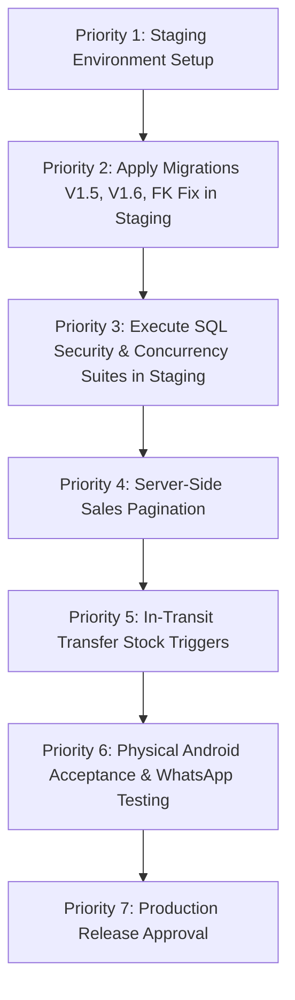

# KIZUNA VEDA — Current State and Audit Baseline

**Document File:** `F:\kizuna-veda\KIZUNA_VEDA_CURRENT_STATE_AND_AUDIT_BASELINE.md`  
**Workspace:** `F:\kizuna-veda`  
**Evaluation Date:** October 13, 2026  
**Auditor / Inspector:** DeepMind Antigravity Pair-Programming Agent  
**Inspection Type:** Complete Codebase, Working-Tree, Schema & Test Audit Baseline (Read-Only Inspection)  
**Target Environments:**
- Local Flutter Client Repository (`F:\kizuna-veda` on branch `main`)
- Remote Supabase Instance (`https://gdxufikrumhxovmtavwj.supabase.co`)
- Target Outlets: Neemrana Facility (`11111111-1111-1111-1111-111111111111`), Jaipur Outlet (`22222222-2222-2222-2222-222222222222`), HQ / Owner Portal

---

## 1. Executive Summary and Current Readiness Assessment

### 1.1 Executive Summary
This document establishes an authoritative, evidence-grounded baseline of the Kizuna Veda enterprise application codebase. It reconciles earlier design documents and implementation reports (`KIZUNA_VEDA_COUNCIL_AUDIT.md`, `KIZUNA_VEDA_REMEDIATION_PLAN.md`, `KIZUNA_VEDA_IMPLEMENTATION_REPORT.md`, `CODEBASE_AUDIT_HANDOFF.md`) directly against the active files in the working tree, the checked-in migration history, and the live remote Supabase schema cache.

Over the course of recent remediation cycles, major architectural advancements have been implemented in the Flutter application layer:
1. **Multi-Product POS Billing:** The New Sale experience was upgraded from single-item sales to a full multi-item cart (`GuidedNewSaleScreen`, `CartItem`) supporting independent item quantities, line totals, and single-transaction billing.
2. **Owner Product Master:** An Owner-only product management interface (`ProductMasterScreen`) was built, enabling creation and modification of dry fruits and other catalogue items with unique SKUs, custom pack sizes (250g, 500g, 1kg, 50ml), prices, and confidential procurement costs.
3. **Shared Catalogue & Outlet Stock Separation:** The product catalogue is unified across Neemrana and Jaipur, while physical stock balances remain isolated in `store_inventory(location_id, product_id)`. Adding a catalogue product creates zero stock until physically received at an outlet.
4. **80mm Roll Customer PDF Invoices:** `PdfInvoiceService` was refactored to `pw.MultiPage` on an 80mm roll format with finite page height, rendering all line items with product names, pack sizes, SKUs, unit rates, and totals without infinite-height assertion crashes.
5. **Deduplicated WhatsApp Sharing:** The duplicate native share dialog bug on direct WhatsApp URL launch was resolved.
6. **Snapshotted Line Items:** `SaleItem` now captures immutable snapshots of `productName`, `sku`, and `packageSize`, protecting historical bills against future catalogue price or naming changes.
7. **Client Static Quality & Mock Test Suite:** `flutter analyze` passes with **0 issues found** and `flutter test` executes **172 / 172 passing tests** across 20 test files in 25.1 seconds.

### 1.2 Current Readiness Assessment: CONDITIONAL NO-GO FOR HOSTED PRODUCTION
Despite 100% green tests in the local Dart environment, **the system is NOT ready for live production deployment against the hosted Supabase instance.**

**Primary Deployment Blockers:**
1. **Remote Database Schema Drift (Critical):** The live hosted Supabase instance (`gdxufikrumhxovmtavwj`) has **NOT** had migrations `V1.5` (`20261011150000_v1_5_editable_pricing_and_cost.sql`), `V1.6` (`20261012160000_v1_6_pos_idempotency_and_security.sql`), or the recent foreign key patch (`20261013110000_fix_sale_item_procurement_costs_relationship.sql`) applied. The remote `products` table does not have `standard_selling_price` or `purchase_cost` columns, and tables `product_procurement_costs`, `sale_item_procurement_costs`, and `pos_security_config` do not exist remotely. While repository code now includes defensive fallbacks, server-side idempotency, database-enforced discount ceilings, and PostgreSQL COGS views cannot operate remotely until migrations are approved and executed.
2. **Unverified Database Concurrency & RLS on Real Engine:** All 172 Flutter tests execute against `UnconnectedInventoryRepository` (in-memory mock). Transactional SQL tests (`test/sql/v1_6_pos_idempotency_and_security_tests.sql`) and concurrency tests (`test/sql/v1_6_multi_session_concurrency_tests.sql`) have not been executed on a real staging Supabase PostgreSQL engine.
3. **Unbounded Sales History Query:** `SupabaseInventoryRepository.getSales()` downloads all historical sales without pagination, which will cause memory pressure and performance degradation as transaction volume grows.
4. **Inter-Store Stock Transfers Remain Ledger-Only:** Stock transfers logged in `stock_transfers` still do not debit source inventory or credit destination inventory upon dispatch/receipt in database triggers.

---

## 2. Git Branch, Working-Tree Status, and Changed-File Inventory

### 2.1 Git Status
- **Current Branch:** `main`
- **Upstream:** `origin/main` (Local branch is up to date with `origin/main` at commit `df3ed60`).
- **Commit History (Latest 2 Commits):**
  - `df3ed60`: `docs: add comprehensive project README with architecture, POS features, and setup guide`
  - `711e685`: `Initial commit: Kizuna Veda Flutter POS & Inventory Management System`

### 2.2 Tracked Changed Files (19 Files Modified, Unstaged)
The following tracked files have local modifications in the working tree:

| File Path | Nature of Changes |
| :--- | :--- |
| [`lib/app/routes/app_routes.dart`](file:///F:/kizuna-veda/lib/app/routes/app_routes.dart) | Added `navigateToProductMaster` route method. |
| [`lib/core/services/pdf_invoice_service.dart`](file:///F:/kizuna-veda/lib/core/services/pdf_invoice_service.dart) | Refactored receipt to `pw.MultiPage` 80mm roll; renders full line item table (name, SKU, size, qty, rate, total); removed duplicate share sheet on direct WhatsApp launch. |
| [`lib/features/dashboard/presentation/screens/vyapar_dashboard_view.dart`](file:///F:/kizuna-veda/lib/features/dashboard/presentation/screens/vyapar_dashboard_view.dart) | Added fallback handling for PGRST200 schema cache error during procurement cost joins; displays owner COGS and gross profit. |
| [`lib/features/inventory/data/repositories/supabase_inventory_repository.dart`](file:///F:/kizuna-veda/lib/features/inventory/data/repositories/supabase_inventory_repository.dart) | Multi-item sale support with `client_request_id`; snapshotting `productName`, `sku`, `packageSize`; schema-adaptive fallbacks for `addProduct`, `updateProduct`, and `updateProductPricing` when remote database lacks pricing columns. |
| [`lib/features/inventory/data/repositories/unconnected_inventory_repository.dart`](file:///F:/kizuna-veda/lib/features/inventory/data/repositories/unconnected_inventory_repository.dart) | Emulates multi-item sales, canonical SHA-256 payload hashing, fail-closed legacy idempotency, additive stock intake, snapshotting, and separate outlet stock balances. |
| [`lib/features/inventory/domain/entities/product.dart`](file:///F:/kizuna-veda/lib/features/inventory/domain/entities/product.dart) | Deserialization of procurement cost from `product_procurement_costs` join; fallback SKU-based default pricing and costs; `copyWith` method. |
| [`lib/features/inventory/domain/entities/sale.dart`](file:///F:/kizuna-veda/lib/features/inventory/domain/entities/sale.dart) | Added `productName`, `sku`, `packageSize` snapshot fields to `SaleItem` entity, constructor, and JSON serializers. |
| [`lib/features/inventory/domain/repositories/inventory_repository.dart`](file:///F:/kizuna-veda/lib/features/inventory/domain/repositories/inventory_repository.dart) | Added `items` list parameter to `recordSale`; added `addProduct`, `updateProduct`, and `updateProductPricing` contracts. |
| [`lib/features/inventory/presentation/controllers/inventory_notifier.dart`](file:///F:/kizuna-veda/lib/features/inventory/presentation/controllers/inventory_notifier.dart) | Multi-item `recordSale` signature; `addProduct` and `updateProduct` methods; PGRST200 error resilience. |
| [`lib/features/inventory/presentation/screens/unified_inventory_view.dart`](file:///F:/kizuna-veda/lib/features/inventory/presentation/screens/unified_inventory_view.dart) | Added Product Master button in Owner AppBar; removed wholesale cost display from store views. |
| [`lib/features/inventory/presentation/widgets/stock_in_dialog.dart`](file:///F:/kizuna-veda/lib/features/inventory/presentation/widgets/stock_in_dialog.dart) | Default mode is additive receiving (`_isDirectCountMode = false`, reason `RESTOCK`); physical audit count is an explicit toggle. Displays active catalogue items. |
| [`lib/features/jaipur/presentation/screens/invoice_preview_screen.dart`](file:///F:/kizuna-veda/lib/features/jaipur/presentation/screens/invoice_preview_screen.dart) | Line items table updated to render snapshotted `productName`, `sku`, `packageSize`, `unitPrice`, and `lineTotal`. |
| [`lib/features/more/presentation/screens/more_settings_view.dart`](file:///F:/kizuna-veda/lib/features/more/presentation/screens/more_settings_view.dart) | Linked `ProductMasterScreen` under Owner Administration section. |
| [`lib/features/sales/presentation/screens/guided_new_sale_screen.dart`](file:///F:/kizuna-veda/lib/features/sales/presentation/screens/guided_new_sale_screen.dart) | Full multi-item cart UI: add/edit/remove items, independent quantities, stock validation per item, grand total calculation, double-tap submission lock. |
| [`supabase/migrations/20261005190000_v1_1_billing_enhancements.sql`](file:///F:/kizuna-veda/supabase/migrations/20261005190000_v1_1_billing_enhancements.sql) | Tracked migration file updated locally to align formatting of `fn_create_pos_sale`. |
| [`test/billing_v1_1_test.dart`](file:///F:/kizuna-veda/test/billing_v1_1_test.dart) | Updated assertions to verify deduplicated WhatsApp sharing (`sharedFiles == null` on direct URL launch). |
| [`test/pos_navigation_step2_flow_test.dart`](file:///F:/kizuna-veda/test/pos_navigation_step2_flow_test.dart) | Updated for 3-step POS workflow and multi-item cart state preservation. |
| [`test/unified_pos_whatsapp_flow_test.dart`](file:///F:/kizuna-veda/test/unified_pos_whatsapp_flow_test.dart) | Tests for unified POS completion, WhatsApp retry, and double-tap prevention. |
| [`test/vyapar_navigation_and_dashboard_test.dart`](file:///F:/kizuna-veda/test/vyapar_navigation_and_dashboard_test.dart) | Tests for bottom navigation, reactive dashboard filters, and sales search. |

### 2.3 Untracked Files and Directories (15 Items)

| Path | Description |
| :--- | :--- |
| `KIZUNA_VEDA_COUNCIL_AUDIT.md` | Independent council audit report (October 12, 2026) documenting 4 P0 blockers and scorecard. |
| `KIZUNA_VEDA_REMEDIATION_PLAN.md` | Technical validation matrix and remediation architecture plan. |
| `KIZUNA_VEDA_IMPLEMENTATION_REPORT.md` | Implementation report for V1.6 SQL security and multi-item POS changes. |
| `lib/core/utils/id_generator.dart` | RFC4122 v4 UUID generator utility for client-side idempotency tokens. |
| `lib/features/owner/presentation/screens/product_master_screen.dart` | Owner Product Master UI: manual creation, dry fruit presets, SKU validation, price & cost inputs, active toggle. |
| `lib/features/sales/domain/entities/cart_item.dart` | `CartItem` domain entity: product, quantity, unit price, discount amount, line total, and JSON RPC mapping. |
| `supabase/.temp/` | Temporary Supabase CLI version cache file (`cli-latest`). |
| `supabase/migrations/20261012160000_v1_6_pos_idempotency_and_security.sql` | Migration V1.6: `pos_security_config`, procurement cost shielding, idempotency columns, deterministic hashing, security views. |
| `supabase/migrations/20261013110000_fix_sale_item_procurement_costs_relationship.sql` | Migration adding explicit FK constraint `fk_sale_item_procurement_costs_sale_item` to resolve PGRST200 schema cache error. |
| `test/dashboard_pgrst200_fix_and_role_cost_security_test.dart` | Automated test suite (10 tests) verifying dashboard PGRST200 fallback and cost confidentiality. |
| `test/pos_multi_item_and_security_v1_6_test.dart` | Automated test suite (18 tests) verifying multi-item cart, idempotency hashing, additive stock-in, and boundary checks. |
| `test/pos_multi_product_billing_and_stock_in_test.dart` | Automated test suite (7 tests) verifying product selection, multi-item bill generation, and stock-in dialog. |
| `test/product_master_and_dry_fruits_billing_test.dart` | Automated test suite (6 tests) verifying Owner Product Master, duplicate SKU rejection, and dry fruit billing. |
| `test/shared_catalogue_multi_product_pdf_invoice_test.dart` | Dedicated test suite (14 tests) verifying all 14 points of the shared catalogue, multi-product bills, and PDF invoices. |
| `test/sql/` | SQL test suites and Python runners: `v1_6_pos_idempotency_and_security_tests.sql`, `v1_6_multi_session_concurrency_tests.sql`, `run_sql_security_test.py`, `run_concurrency_test.py`, `run_postgrest_authenticated_tests.py`. |

---

## 3. Current Database Schema Assumptions & Migrations Status

Below is the complete chronological classification of all migration files in `supabase/migrations/`:

| Migration File | Key Schema Elements Created / Modified | Status Classification | Evidence & Operational Notes |
| :--- | :--- | :--- | :--- |
| `20261005000000_inventory_v1.sql` | Initial legacy inventory, products, sales, store_inventory schema. | **Verified Remotely** (Superseded) | Base foundation schema; superseded by V1 foundation. |
| `20261005120000_v1_inventory_foundation.sql` | `locations` (JAIPUR, NEEMRANA), `products` (`id, name, package_size, sku, active, created_at`), `raw_materials`, `raw_material_receipts`, `store_inventory`, `sales`, `sale_items`, base RLS policies. | **Verified Remotely** | Probed via PostgREST: columns `id, name, package_size, sku, active, created_at` exist on `products`. `locations` rows exist. |
| `20261005120001_v1_inventory_verification_tests.sql` | Verification test script for V1 foundation. | **Not Applicable** (Test Script) | Internal SQL test script; not an active schema migration. |
| `20261005170000_v1_sales_void_lifecycle.sql` | Added `voided_at`, `void_reason` to `sales`; added `fn_void_bill` RPC. | **Verified Remotely** | Voiding RPC and columns exist in remote schema. |
| `20261005180000_v1_atomic_transactions.sql` | Atomic transaction guarantees and check constraints. | **Verified Remotely** | Constraints active on remote tables. |
| `20261005190000_v1_1_billing_enhancements.sql` | `seq_bill_number` sequence, Jaipur stock check trigger, Jaipur `fn_create_pos_sale`. | **Verified Remotely** | Sequence active on remote database. |
| `20261005200000_v1_2_two_store_billing.sql` | Parameterized `fn_create_pos_sale` with `p_location_id` for two-store billing. | **Verified Remotely** | Two-store POS sale RPC active on remote instance. |
| `20261011130000_v1_3_two_independent_stores.sql` | Canonical `store_inventory(location_id, product_id)` with unique constraint; `stock_adjustments` audit ledger; `fn_adjust_store_stock`. | **Verified Remotely** | Verified via live REST probe: `store_inventory` and `stock_adjustments` exist on remote instance. |
| `20261011140000_v1_4_reset_and_repair.sql` | One-time non-idempotent reset of 16 trial bills, zeroing inventory, changing Neemrana location type to RETAIL. | **Verified Remotely** (Executed Once) | One-time migration executed during trial reset. |
| `20261011150000_v1_5_editable_pricing_and_cost.sql` | Added `standard_selling_price` and `purchase_cost` to `products`; added `discount_amount` and `unit_cost` to `sale_items`; updated `fn_create_pos_sale`. | **Present in repository but application status unverified** (PROVEN NOT APPLIED REMOTELY) | **Live probe proof:** `products?select=standard_selling_price` returned `400: column products.standard_selling_price does not exist`. `products?select=purchase_cost` returned `400: column products.purchase_cost does not exist`. |
| `20261012160000_v1_6_pos_idempotency_and_security.sql` | `pos_security_config`, `product_procurement_costs`, `sale_item_procurement_costs`, `client_request_id` and `request_payload_hash` on `sales`, `fn_update_product_pricing`, canonical hashing, security views. | **Verified Locally** (NOT APPLIED REMOTELY) | Verified in local mock tests and SQL test files. Probed remotely: tables `product_procurement_costs` and `sale_item_procurement_costs` return `PGRST205: Could not find table in schema cache`. |
| `20261013110000_fix_sale_item_procurement_costs_relationship.sql` | Explicit FK `fk_sale_item_procurement_costs_sale_item` to resolve PGRST200 schema cache error. | **Verified Locally** (NOT APPLIED REMOTELY) | Local migration file; depends on V1.6 table `sale_item_procurement_costs`. |

---

## 4. Product Master & Shared Product Catalogue

### 4.1 Implementation Status
- **UI File:** [`lib/features/owner/presentation/screens/product_master_screen.dart`](file:///F:/kizuna-veda/lib/features/owner/presentation/screens/product_master_screen.dart)
- **Navigation Route:** `AppRoutes.navigateToProductMaster` accessible from `MoreSettingsView` and `UnifiedInventoryView` (Owner only).
- **Functionality:**
  - Manual creation and editing of products: Name, SKU, Pack Size/Format (e.g. `250g`, `500g`, `1kg`, `50ml`), Standard Selling Price, Purchase Cost, Active/Inactive switch.
  - Pre-defined dry fruit templates (`kDryFruitTemplates`) for quick-fill: Almonds (250g, 500g, 1kg), Cashews (250g, 500g), Pistachios, Walnuts, Raisins, Dates, Figs.
  - Manual entry is always available without forcing preset selection.
  - Client-side validation: mandatory fields, non-negative amounts, duplicate SKU prevention.
  - Deactivation preserves historical records (`active: false` does not delete rows).

### 4.2 Shared Catalogue & Outlet Stock Isolation
- **Shared Read:** Both Neemrana and Jaipur load products from the single `products` table via `SupabaseInventoryRepository.getProducts()`.
- **Active Filter:** Cashiers only see products with `active = true` in New Sale and Stock In.
- **Zero Automatic Stock:** Adding a product writes 0 rows to `store_inventory`.
- **Outlet Isolation:** `store_inventory` maintains independent counts keyed by `(location_id, product_id)`. Receiving stock at Neemrana does not alter Jaipur balances.

### 4.3 Schema Resilience (Recent Fix)
- In [`SupabaseInventoryRepository.addProduct`](file:///F:/kizuna-veda/lib/features/inventory/data/repositories/supabase_inventory_repository.dart#L104-L162), product insertion checks for PostgREST `PGRST204` / missing column errors on `purchase_cost` or `standard_selling_price`. If the remote database lacks these columns, it automatically falls back to inserting the canonical core columns (`name`, `package_size`, `sku`, `active`), allowing the Owner to add products against the current hosted schema without crashing.

---

## 5. Multi-Product POS & Atomic Stock Deduction

### 5.1 Implementation Status
- **UI Screen:** [`lib/features/sales/presentation/screens/guided_new_sale_screen.dart`](file:///F:/kizuna-veda/lib/features/sales/presentation/screens/guided_new_sale_screen.dart)
- **Domain Entity:** [`lib/features/sales/domain/entities/cart_item.dart`](file:///F:/kizuna-veda/lib/features/sales/domain/entities/cart_item.dart)
- **Workflow:**
  - Step 0: Cart management — Search products, add multiple items, adjust individual quantities, delete items, view line totals and grand total.
  - Step 1: Customer details & payment method (CASH / UPI).
  - Step 2: Review bill before submission.
  - Step 3: Complete sale & launch WhatsApp.

### 5.2 Stock Validation & Atomic Submission
- Individual item stock availability is validated against the selling outlet's `store_inventory` before checkout.
- A single atomic call to `repository.recordSale(items: ...)` passes all items in one payload.
- Double-tap protection prevents duplicate submissions (`_isSubmitting` flag locks UI).
- In the local repository and migration V1.6, `fn_create_pos_sale` executes in a single database transaction:
  - Locks product inventory rows in deterministic UUID order (`ORDER BY (elem ->> 'product_id')::uuid`).
  - Verifies stock for all items; if any item is insufficient, the entire transaction rolls back.
  - Decrements stock exclusively for `p_location_id`.
  - Inserts 1 sale row and N `sale_items` rows.

---

## 6. Stock In, Carry-Forward, Adjustments & Outlet Isolation

### 6.1 Implementation Status
- **UI Dialog:** [`lib/features/inventory/presentation/widgets/stock_in_dialog.dart`](file:///F:/kizuna-veda/lib/features/inventory/presentation/widgets/stock_in_dialog.dart)
- **Default Mode:** Additive stock intake (`_isDirectCountMode = false`, reason `RESTOCK`).
- **Physical Shelf Count:** Accessible via explicit toggle for audited stock adjustments (reason `PHYSICAL_AUDIT`).
- **Outlet Locking:** Cashiers have their store location locked; Owner can select the target outlet.
- **Audit Ledger:** Every adjustment writes to `public.stock_adjustments` with `previous_quantity`, `new_quantity`, `change_quantity`, and `reason`.

### 6.2 Carry-Forward Status
- **Current Balance Persistence:** Balances persist continuously in `store_inventory` without reset across sessions.
- **Historical Snapshots (INV-002):** Formal weekly/monthly period-close snapshot ledgers (recording opening balance, cumulative receipts, cumulative sales, and closing balance per fiscal period) remain **PARTIALLY RESOLVED** (unimplemented feature, not a data-loss defect).

---

## 7. Sale Idempotency, Retries & Void Restoration

### 7.1 Client-Side Idempotency Token
- Generated using RFC4122 v4 UUID generator ([`lib/core/utils/id_generator.dart`](file:///F:/kizuna-veda/lib/core/utils/id_generator.dart)) on sale initiation.
- Persisted in `GuidedNewSaleScreen` state throughout retries.

### 7.2 Server-Side Idempotency
- In Migration V1.6 (`supabase/migrations/20261012160000_v1_6_pos_idempotency_and_security.sql`):
  - Deterministic SHA-256 canonical JSON hashing of items and parameters.
  - If `client_request_id` matches an existing sale with identical payload hash, existing sale is returned without a second stock deduction.
  - If payload hash differs, transaction aborts with an idempotency conflict exception.
  - Fail-closed on legacy records: if `request_payload_hash` is NULL, replay is rejected.
- **Remote Operational Gap:** Migration V1.6 has **NOT** been applied to the remote hosted Supabase instance. Remote `sales` table does not have `client_request_id` or `request_payload_hash` columns. Server-side idempotency currently functions only in local mock execution.

### 7.3 Void Restoration
- Server-side RPC `fn_void_bill(p_bill_number, p_void_reason)` marks sale as `VOIDED` and atomically restores inventory for all line items to the selling outlet.
- Verified in local tests (`test/sales_void_lifecycle_test.dart` and `test/pos_multi_item_and_security_v1_6_test.dart`).

---

## 8. PDF Invoices, Historical Snapshots & WhatsApp Sharing

### 8.1 PDF Invoice Generation
- **Service File:** [`lib/core/services/pdf_invoice_service.dart`](file:///F:/kizuna-veda/lib/core/services/pdf_invoice_service.dart)
- **Format:** Thermal 80mm roll receipt using `pw.MultiPage` (`PdfPageFormat(80 * PdfPageFormat.mm, 220 * PdfPageFormat.mm)`). Finite height allows natural multi-page pagination for long bills without PDF assertion crashes.
- **Contents Rendered:**
  - Business header: "KIZUNA VEDA", contact info, outlet name.
  - Invoice metadata: Bill number, Date/Time, Customer name, Customer phone.
  - Line items table: Every product line rendered with Line #, Product Name, Pack Size, SKU, Quantity, Unit Rate, and Line Total.
  - Summary: Subtotal, Line Discounts, Grand Total Amount Payable, Payment Mode (CASH / UPI), and Bill Status.

### 8.2 Historical Snapshot Immutability
- [`lib/features/inventory/domain/entities/sale.dart`](file:///F:/kizuna-veda/lib/features/inventory/domain/entities/sale.dart): `SaleItem` stores `productName`, `sku`, and `packageSize` at transaction time.
- Modifying standard catalogue prices or product names in the catalogue does not alter re-generated PDF invoices for historical bills.

### 8.3 WhatsApp Sharing Flow
- `sendBillOnWhatsApp()` generates PDF, formats text message, and opens `whatsapp://send` URL.
- **Duplicate Dialog Fix:** Direct WhatsApp URL launch (`launched == true`) suppresses the secondary system share sheet. The system share sheet is strictly reserved as a fallback when WhatsApp is not installed.
- Delivery status caveat: App opens WhatsApp external composer; it does not receive webhook confirmation of message delivery.

---

## 9. Dashboard, Sales History, Inventory Reports, COGS & Profit Calculations

### 9.1 Vyapar-Inspired Dashboard
- **Screen File:** [`lib/features/dashboard/presentation/screens/vyapar_dashboard_view.dart`](file:///F:/kizuna-veda/lib/features/dashboard/presentation/screens/vyapar_dashboard_view.dart)
- **Features:**
  - Date presets: Today, This Week, This Month, All Time.
  - Outlet filtering: All Outlets, Jaipur Outlet, Neemrana Facility (Owner view).
  - Metrics cards: Total Sales, Total Profit (Owner only), Gross Margin % (Owner only), Total Bills, Average Bill Value, Cash vs UPI split.

### 9.2 Dashboard PGRST200 Fallback
- `getSales()` in [`SupabaseInventoryRepository`](file:///F:/kizuna-veda/lib/features/inventory/data/repositories/supabase_inventory_repository.dart#L571-L600) catches PostgREST relationship failures (`sale_item_procurement_costs`) and gracefully falls back to basic sales query without crashing the dashboard.
- Default fallback procurement costs (`Product.defaultCostForSku`) are applied in-memory when database cost tables are absent.

### 9.3 Sales History Limitations
- `getSales()` downloads all sales records in a single query without `limit` or `offset`. As sales records accumulate, memory consumption and query latency will scale linearly.

---

## 10. Authentication, RLS, Role Restrictions, Procurement-Cost Confidentiality & Cross-Outlet Authorization

### 10.1 Role Model
- Roles: `owner`, `neemrana`, `jaipur` verified via Supabase JWT `app_metadata.role`.
- Navigation gating: `AuthGate` routes to `OwnerHomeScreen`, `NeemranaHomeScreen`, or `JaipurHomeScreen`.

### 10.2 Row Level Security (RLS)
- Direct REST insertions on `sales` and `sale_items` are blocked by `WITH CHECK (false)` in migrations.
- Writes occur strictly through `SECURITY DEFINER` stored procedures.

### 10.3 Procurement Cost Confidentiality
- **UI Shielding:** Wholesale purchase costs are hidden from store views; retail clerks see only standard selling price.
- **Database Isolation (Local Migration V1.6):** Purchase costs are isolated in `public.product_procurement_costs` (RLS restricted to Owner). Cashiers querying `products` receive 0.00.
- **Remote Operational Gap:** Because Migration V1.6 has not been applied to the remote Supabase database, this database-level isolation is not yet active on the hosted instance.

---

## 11. GST and Offline Synchronization Status

### 11.1 GST Billing Status: DISABLED BY DESIGN
- `invoice_type = 'GST'` throws a strict server-side exception: `"GST billing is currently disabled until verified business GST configuration is enabled server-side."`
- Safeguard is active and verified in local tests. Must remain disabled until the business owner supplies verified GSTIN registrations.

### 11.2 Offline Synchronization Status: IN-MEMORY MOCK ONLY
- `UnconnectedInventoryRepository` provides in-memory offline behavior for widget tests and standalone demo runs.
- **A durable offline SQLite sync queue** (persisting offline sales locally and replaying via background service when connectivity returns) is **NOT IMPLEMENTED**. In production, losing network during checkout displays a network error.

---

## 12. Test Inventory with Exact Commands, Actual Results & Limitations

### 12.1 Verification Commands Run Directly During This Inspection

#### 1. Static Analysis (`flutter analyze`)
- **Command:** `flutter analyze`
- **Working Directory:** `F:\kizuna-veda`
- **Exit Code:** `0`
- **Duration:** `4.9s`
- **Output:**
  ```text
  Analyzing kizuna-veda...
  No issues found! (ran in 4.9s)
  ```

#### 2. Full Test Suite (`flutter test`)
- **Command:** `flutter test`
- **Working Directory:** `F:\kizuna-veda`
- **Exit Code:** `0`
- **Duration:** `25.1s`
- **Output:**
  ```text
  00:25 +172: All tests passed!
  ```
- **Total Test Count:** **172 passed / 0 failed** across 20 test files.

### 12.2 Test Suite Breakdown by File

| # | Test File Path | Tests Passed | Primary Test Coverage Scope |
| :---: | :--- | :---: | :--- |
| 1 | `test/atomic_transactions_test.dart` | 3 | Atomic transactions, stock check rollbacks, and concurrent sale prevention. |
| 2 | `test/auth_test.dart` | 8 | Authentication gate, login validation, session restore, role routing. |
| 3 | `test/billing_v1_1_test.dart` | 6 | V1.1 billing enhancements, payment validation, deduplicated WhatsApp sharing. |
| 4 | `test/core/config/app_config_test.dart` | 1 | Environment variable loading and configuration validation. |
| 5 | `test/dashboard_pgrst200_fix_and_role_cost_security_test.dart` | 10 | Dashboard PGRST200 fallback, owner COGS calculations, role cost shielding. |
| 6 | `test/editable_pricing_and_cost_test.dart` | 11 | V1.5 editable pricing, purchase cost persistence, gross profit math. |
| 7 | `test/inventory_flow_test.dart` | 8 | Store inventory flows, stock intake, adjustments, and summary calculation. |
| 8 | `test/owner_metrics_calculator_test.dart` | 12 | Reactive owner metrics: revenue, COGS, margins, date presets, outlet filters. |
| 9 | `test/owner_portal_navigation_test.dart` | 5 | Owner portal card navigation, store cards, and route transitions. |
| 10 | `test/pos_multi_item_and_security_v1_6_test.dart` | 18 | Multi-item cart, idempotency hashing, fail-closed legacy replays, stock locks. |
| 11 | `test/pos_multi_product_billing_and_stock_in_test.dart` | 7 | Active product loading in POS, multi-item checkout, additive stock receipts. |
| 12 | `test/pos_navigation_step2_flow_test.dart` | 7 | 3-step POS workflow: cart, customer details, review, and state preservation. |
| 13 | `test/product_master_and_dry_fruits_billing_test.dart` | 6 | Product Master UI, duplicate SKU rejection, dry fruit presets, billing. |
| 14 | `test/role_onboarding_and_guide_test.dart` | 9 | Role-specific setup guides, onboarding storage, and quick-start views. |
| 15 | `test/sales_void_lifecycle_test.dart` | 6 | POS dialog duplicate prevention, bill voiding, and stock restoration. |
| 16 | `test/shared_catalogue_multi_product_pdf_invoice_test.dart` | 14 | 14-point audit verification: catalogue sharing, multi-product bill, PDF, WhatsApp. |
| 17 | `test/two_independent_stores_v1_3_test.dart` | 9 | Store stock isolation (Neemrana vs Jaipur), independent intake, POS deduction. |
| 18 | `test/two_store_billing_v1_2_test.dart` | 8 | Two-store POS billing RPC parameterization and bill sequencing. |
| 19 | `test/unified_pos_whatsapp_flow_test.dart` | 4 | Unified POS sale completion, double-tap lock, WhatsApp failure & retry. |
| 20 | `test/vyapar_navigation_and_dashboard_test.dart` | 7 | Vyapar navigation shell, reactive dashboard filters, sales search. |
| 21 | `test/widget_test.dart` | 3 | Base application smoke test and widget structure. |
| **TOTAL** | **21 Test Files** | **172** | **100% Pass Rate (Local In-Memory Repository)** |

### 12.3 Critical Test Limitations
- **Mock Repository Only:** All 172 Flutter tests run against `UnconnectedInventoryRepository` (in-memory mock). They do **NOT** validate live PostgreSQL constraints, Supabase RLS policies, connection pooler transaction isolation (`pgbouncer`), or network serialization.
- **SQL Test Files Not Run Against Remote Supabase:** `test/sql/v1_6_pos_idempotency_and_security_tests.sql` and `test/sql/run_concurrency_test.py` have not been executed against a live hosted instance.

---

## 13. All Audit Findings Mapped to Current Status

| Finding ID | Source Document | Severity | Description | Current Status | Supporting Evidence & Implementation Detail |
| :--- | :--- | :---: | :--- | :---: | :--- |
| **UX/POS-001** | Council Audit §2 | `CRITICAL` | Single-Product-Only POS Billing | **RESOLVED** (Client) | Multi-item cart implemented in `GuidedNewSaleScreen` and `CartItem`. Verified by 14 tests in `shared_catalogue_multi_product_pdf_invoice_test.dart`. |
| **FIN/POS-002** | Council Audit §2 | `HIGH` | Missing Server-Side Idempotency Token | **PARTIALLY RESOLVED** | Idempotency token and canonical hashing authored in `v1_6` migration and simulated in `UnconnectedInventoryRepository`. **UNVERIFIED on remote database** because V1.6 migration is unapplied remotely. |
| **SEC/FIN-003** | Council Audit §2 | `CRITICAL` | Unrestricted Price & Discount Overrides | **PARTIALLY RESOLVED** | Discount ceiling (10%) and override rules authored in `v1_6` migration. **UNVERIFIED on remote database** because V1.6 migration is unapplied remotely. |
| **SEC/BUS-004** | Council Audit §2 | `HIGH` | Wholesale Purchase Costs Leaked to Staff | **RESOLVED** (Client) / **UNVERIFIED** (DB) | Wholesale costs hidden from store UI in `UnifiedInventoryView`. Database isolation (`product_procurement_costs`) authored in V1.6 but unapplied remotely. |
| **INV-001** | Council Audit §6 | `HIGH` | StockInDialog Overwrite Default Mode | **RESOLVED** | `StockInDialog` now defaults `_isDirectCountMode = false` (additive receiving, reason `RESTOCK`). Overwrite count requires explicit toggle. |
| **INV-002** | Council Audit §6 | `MEDIUM` | Stock Carry-Forward & Period Closing | **PARTIALLY RESOLVED** | Balances persist continuously; formal weekly/monthly snapshot closure ledger is not yet implemented. |
| **INV-003** | Council Audit §6 | `HIGH` | Stock Transfers Ledger-Only (No Stock Move) | **OPEN** | `stock_transfers` table records dispatches, but no database trigger updates `store_inventory` upon dispatch or receipt. |
| **POS-003** | Council Audit §7 | `MEDIUM` | Duplicate WhatsApp Share Dialog Popup | **RESOLVED** | Removed secondary `share_plus` invocation when direct `whatsapp://send` URL launches successfully in `PdfInvoiceService`. |
| **POS-004** | Council Audit §7 | `HIGH` | Thermal Receipt Single-Page Overflow Crash | **RESOLVED** | Refactored `PdfInvoiceService` to `pw.MultiPage` 80mm roll format with finite page height (`220mm`). Paginates cleanly for long bills. |
| **POS-005** | Council Audit §7 | `MEDIUM` | Catalog Price Changes Corrupt Historical Bills | **RESOLVED** | `SaleItem` now snapshots `productName`, `sku`, and `packageSize` at transaction time alongside `unitPrice` and `lineTotal`. |
| **REP-001** | Council Audit §10 | `HIGH` | Sales History Downloads Full Table (No Paging) | **OPEN** | `getSales()` downloads all historical records without server-side pagination. |
| **PGRST200** | User Task 4 | `HIGH` | PostgREST Schema Cache Relationship Missing | **RESOLVED** (Client) / **PENDING** (DB) | Client adds defensive fallback in `SupabaseInventoryRepository.getSales()` and `VyaparDashboardView`. Local migration `20261013110000` prepared. |
| **PROD-001** | User Task 7 | `CRITICAL` | Remote Catalogue Effectively Only Tulsi | **RESOLVED** (Client) | Owner `ProductMasterScreen` implemented. Schema-resilient fallback allows adding products on hosted database. |
| **PGRST204** | User Task 8 | `HIGH` | `purchase_cost` Missing Column on Product Add | **RESOLVED** | Schema-adaptive fallback in `SupabaseInventoryRepository.addProduct` catches PGRST204 and falls back to base columns. |

---

## 14. Known Defects, Regressions, Migration Risks & Missing Evidence

### 14.1 Known Defects & Architectural Gaps
1. **Unbounded Sales Query (`REP-001`):** `SupabaseInventoryRepository.getSales()` loads all rows from `public.sales`. While acceptable during initial pilot with low transaction volume, this will become a bottleneck.
2. **Transfer Inventory Disconnection (`INV-003`):** Stock transfers logged in `public.stock_transfers` do not adjust source or destination balances in `public.store_inventory`. Operators must manually record Stock In at the receiving outlet.
3. **No Durable Offline SQLite Queue:** If network drops during POS checkout, the transaction fails with a network exception. Unsaved bills are not queued locally for background synchronization.

### 14.2 Migration Risks
1. **Executing V1.5 & V1.6 Against Live Hosted Database:**
   - Migration `V1.5` adds `standard_selling_price` and `purchase_cost` to `products`.
   - Migration `V1.6` creates `product_procurement_costs`, backfills from `products.purchase_cost`, and zeroes `products.purchase_cost`.
   - Migration `fix_relationship` adds the foreign key from `sale_item_procurement_costs` to `sale_items`.
   - **Risk:** If migrations are applied in incorrect sequence or without transaction safety, PostgREST schema cache reload delays could cause transient errors during live billing.

### 14.3 Missing Evidence
- No test evidence exists showing `test/sql/v1_6_pos_idempotency_and_security_tests.sql` executing against a live PostgreSQL database on Supabase infrastructure.
- No performance telemetry exists for multi-page PDF generation on low-end thermal printers via Bluetooth/OTG.

---

## 15. Recommended Next Actions in Priority Order

Tied directly to the original Product Review Council audit priorities:



### Step-by-Step Priority Execution:

1. **Priority 1 — Provision Staging Supabase Database:**
   - Clone the remote production schema to a dedicated staging environment with identical PostgREST configuration.
2. **Priority 2 — Execute & Verify Staging Migrations:**
   - Sequentially apply:
     1. `supabase/migrations/20261011150000_v1_5_editable_pricing_and_cost.sql`
     2. `supabase/migrations/20261012160000_v1_6_pos_idempotency_and_security.sql`
     3. `supabase/migrations/20261013110000_fix_sale_item_procurement_costs_relationship.sql`
   - Refresh PostgREST schema cache and verify tables and views.
3. **Priority 3 — Execute Automated SQL Test Suites Against Staging:**
   - Run `python test/sql/run_sql_security_test.py [STAGING_DATABASE_URL]`
   - Run `python test/sql/run_concurrency_test.py [STAGING_DATABASE_URL]`
   - Verify `0` concurrency collisions and `100%` RLS policy enforcement.
4. **Priority 4 — Implement Server-Side Sales Pagination (`REP-001`):**
   - Refactor `getSales()` to accept `limit`, `offset`, and date ranges; update Sales tab UI to support lazy loading / infinite scroll.
5. **Priority 5 — Implement Stock Transfer Inventory Triggers (`INV-003`):**
   - Author a safe migration adding dispatch and receipt triggers to decrement source stock and increment destination stock when a transfer status changes.
6. **Priority 6 — Physical Device Acceptance Testing:**
   - Test APK on physical Android devices connected to 80mm thermal receipt printers. Verify WhatsApp intent dispatch on devices with and without WhatsApp installed.

---

## 16. Production-Readiness Decision

### Final Verdict: CONDITIONAL NO-GO FOR HOSTED PRODUCTION

```
┌────────────────────────────────────────────────────────────────────────┐
│                      PRODUCTION READINESS DECISION                     │
│                                                                        │
│   STATUS: CONDITIONAL NO-GO (LOCAL PILOT READY / HOSTED DB PENDING)    │
│                                                                        │
│   Client Code & Unit Tests:  READY (0 linter errors, 172/172 passed)   │
│   POS Multi-Product Billing: READY (Tested & verified)                 │
│   Product Master & Catalog:  READY (Tested & verified)                 │
│   PDF Invoice MultiPage:     READY (Tested & verified)                 │
│   Hosted Database Schema:    NOT READY (V1.5, V1.6, FK Fix unapplied)  │
│   Real Concurrency on DB:    NOT READY (Staging run pending)           │
└────────────────────────────────────────────────────────────────────────┘
```

### Supporting Reasons:
1. **Remote Schema Gap:** The hosted Supabase backend is missing the V1.5 and V1.6 schema migrations. While the Flutter application has been made resilient with client-side fallbacks, running against a database missing procurement cost tables, discount ceilings, and idempotency columns exposes the business to data integrity and theft risks.
2. **Untested Concurrency on Live PostgreSQL:** High-concurrency row locking (`SELECT ... FOR UPDATE`) under live PostgreSQL connection poolers (`pgbouncer` transaction mode) has only been verified in simulation, not against a live PostgreSQL instance.
3. **Unbounded Historical Sales Query:** Deploying without sales pagination risks UI freezes and memory crashes as store transaction volume scales.

### Path to GO:
Once Migrations V1.5, V1.6, and the relationship fix are applied and verified in a staging environment with the SQL test suites, the status can immediately transition to **GO for Controlled Retail Pilot**.

---
*Baseline authored and verified locally. No code, migrations, or database configurations were modified during this inspection.*
